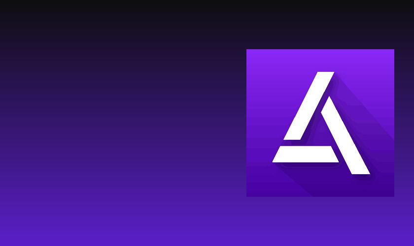

<h1 align="center">
  <br>
  DeltaVita · PS Vita Port
</h1>

<p align="center">
  <a href="#-status--playability">Status & Playability</a> •
  <a href="#setup-instructions-for-players">How to install</a> •
  <a href="#controls">Controls</a> •
  <a href="#known-issues">Known Issues</a> •
  <a href="#build-instructions-for-developers">How to compile</a> •
  <a href="#credits--acknowledgments">Credits</a>
</p>

> [!IMPORTANT]
> **Unofficial port.** DeltaVita is a fan-made, unofficial port inspired by Delta. It is **not affiliated with, endorsed, sponsored or supported by Riley Testut, AltStore LLC or the Delta project**. "Delta" and the Delta logo belong to their respective owners. Please do not report DeltaVita issues to the Delta project. No games, BIOS files or Delta skins are distributed with DeltaVita.
>
> **Port no oficial.** DeltaVita es un port no oficial hecho por fans, sin relación ni respaldo de Riley Testut, AltStore LLC ni del proyecto Delta.

An unofficial, native **PS Vita take on [Delta](https://github.com/rileytestut/Delta)**, Riley Testut's multi-system iOS emulator. DeltaVita is not affiliated with Delta or Riley Testut. It is a native launcher (vita2d) plus one libretro core per console, each statically linked into its own app and started with `sceAppMgrLoadExec`. Its sister project is [DeltaDroid](https://github.com/MetalSyntax/DeltaDroid) (Android).

---

## 🎮 Status & Playability

**Status: BUILDS (not yet tested on a real console)**

The VPK builds, but the first run on a physical PS Vita is still pending. Nothing below is marked as verified on hardware yet.

- [x] **Build**: `DeltaVita.vpk` (title ID `DLTV00001`, version `01.00`) compiles from source.
- [ ] **Launcher**: Delta-style library, one page per console, cover grid, front touch selection.
- [ ] **NES** (fceumm), **SNES** (snes9x2005), **GB/GBC** (gambatte), **GBA** (gpsp, dynarec via VM memblock), **Genesis / Mega Drive** (genesis_plus_gx): core runs and game launches.
- [ ] **DS** (desmume2015): experimental, interpreter, slow.
- [ ] **N64** (parallel_n64): **not included yet**. Its upstream Vita target is broken (it references a removed `empty_dynarec.c`), and with an interpreter plus software renderer it would run at a few FPS. The launcher, skin and controls are ready for it.
- [ ] **Saves**: battery saves (SRAM) and save states survive a restart.
- [ ] **Skins**: Delta skins in portrait and landscape.
- [ ] **Audio**, **fast-forward**, **cheat codes**, **box art download** over Wi-Fi.

---

## Disclaimer

**Delta** is a project by **Riley Testut**. DeltaVita is an unofficial port and is not produced, endorsed, or sanctioned by Riley Testut or any affiliated entities.

This software does NOT contain game ROMs, BIOS files, original game code, copyrighted graphics, or game assets. The Delta skins and the app icon used by DeltaVita are obtained from **your own** Delta IPA by the build scripts; they are not distributed in this repository. The authors do not promote or condone piracy in any way. To play, you must provide your own legally obtained game ROMs and, where a system requires it, your own BIOS files.

---

## Setup Instructions (For Players)

1. **Install the VPK**: install `DeltaVita.vpk` with VitaShell.
2. **Copy your ROMs** to `ux0:data/DeltaVita/roms/` (subfolders are read up to 2 levels deep).
3. **Optional BIOS**: place files required by a system in `ux0:data/DeltaVita/system/`.
4. **Optional skins**: copy converted skins to `ux0:data/DeltaVita/skins/<console>/` (see [Skins](#skins)).
5. **Start DeltaVita** and pick a console page.

The data folder is created automatically:

```
ux0:data/DeltaVita/
  roms/           your game files (subfolders up to 2 levels)
  saves/          battery saves (SRAM)
  states/<rom>/   save states (8 slots + Auto Save)
  cheats/         cheat code lists
  covers/         box art (downloaded or added by you)
  screenshots/    screenshots taken from the pause menu
  skins/<console>/ skins per console (nes snes gbc gba n64 ds genesis)
  system/         optional BIOS files
  config.txt      settings
  titles.txt      game titles
  launcher.log    launcher log
  runner.log      emulation log
```

Interface language is Spanish or English, following the system language.

### Skins

Delta `.deltaskin` files are used in the `iphone` / `standard` representation (667x375, close to the Vita's aspect ratio), in portrait and landscape. The Vita cannot render PDF, so skin PDFs are pre-rendered on a PC with `tools/deltaskin2vita.py` (poppler `pdftocairo -transp` + Pillow). Convert a skin, then copy it to `ux0:data/DeltaVita/skins/<console>/`.

On-screen skin buttons respond to multitouch. The N64 skin uses the analog thumbstick, and the DS skin maps its touch screen to the front touch panel.

---

## Controls

Physical buttons are mapped by position, as in Delta.

| Input | Action | Status |
| :---: | :--- | :---: |
| **✕** | B | not verified yet |
| **○** | A | not verified yet |
| **□** | Y | not verified yet |
| **△** | X (in the library: game options) | not verified yet |
| **L / R** | L / R (N64: L = Z). Library: switch console page | not verified yet |
| **START** | START (in the library: settings) | not verified yet |
| **SELECT** | SELECT | not verified yet |
| **Left stick** | D-pad (N64: analog stick) | not verified yet |
| **Right stick** | N64 C-buttons | not verified yet |
| **SELECT + START** | Open the pause menu (or the skin's MENU button) | not verified yet |

> [!TIP]
> The pause menu has **Save State**, **Load State** (8 slots + Auto Save, PNG thumbnails, date, △ lock, □ delete), **Fast Forward**, **Reset**, **Screenshot**, **Cheat Codes** (add with the system keyboard, toggle, delete; Game Genie / Action Replay / GameShark depending on the core), **Hold Buttons** (tap a button to keep it held, tap again to release), **Mute**, **Use Skin**, **Rotate Screen**, and **Quit**. Battery saves are written when you pause and when you exit; an auto save state is written on exit.

In the library, **△** opens game options: **Play**, **Rename** (system keyboard), **Delete game**.

---

## Display Modes & Limitations

| Setting | Options |
| :--- | :--- |
| **Orientation** | Landscape or portrait. In portrait, everything (menus included) is rendered into a 544x960 target rotated 90°. Hold the Vita rotated with its left edge up. The D-pad and sticks rotate with the image. |
| **Skin** | No skin, Standard (Delta), or imported skins, per console |
| **Skin opacity** | Adjustable for translucent landscape skins |
| **Scaling without skin** | Fit, Integer, or Stretch |
| **Filter** | Smooth filter on/off |
| **Fast-forward** | 2x, 3x, 4x, 8x |
| **Box art** | Download over Wi-Fi (libretro-thumbnails, matched by No-Intro file name, saved to `ux0:data/DeltaVita/covers/`) |

---

## Known Issues

- **Not tested on hardware yet**: the first console run is pending. Expect crashes or wrong behavior until it is done.
- **DS is experimental and slow** (interpreter); **N64 is not included yet** (see Status).
- **Box art download skips TLS certificate verification**: the Vita has no CA store for curl. Only public images are downloaded.
- **Skins**: only the `iphone` / `standard` representation is used.
- **Cheat codes**: one cheat code list per game.
- **PAL games** are paced against the 60 Hz display.
- **Crash dumps** are written by the system to `ux0:data/` (not to the game folder).

---

## Build Instructions (For Developers)

### Prerequisites

- [VitaSDK](https://vitasdk.org/) (`$VITASDK`).
- CMake 3.16+, Ninja, Python 3, `git`, and `unzip`/`poppler` for the asset tools.
- Optional: your own Delta IPA, to extract the Standard skins.

Skins, cores and IPA content are **not** in the repository.

### Compilation Commands

```bash
git clone <this repository>
cd DeltaVita
# 1. build the libretro cores as static libraries for Vita (cloned into cores/src, output in cores/lib)
tools/build_cores.sh
# 2. optional: extract and convert Delta's Standard skins from YOUR OWN Delta IPA into assets/skins
tools/fetch_assets.sh /path/to/Delta.ipa
# 3. build the VPK
cmake -S . -B build -G Ninja -DCMAKE_POLICY_VERSION_MINIMUM=3.5
cmake --build build
```

The result is `build/DeltaVita.vpk`. `tools/build_cores.sh` patches the cores' Makefiles from hard-float to softfp, because this VitaSDK is softfp. Cores that fail to build are skipped, and the matching console is left out of the VPK.

### Deploy & Debug

```bash
Upload `build/DeltaVita.vpk` with VitaShell's FTP server (e.g. `curl -T build/DeltaVita.vpk ftp://<vita-ip>:1337/ux0:/downloads/`) and install it from VitaShell. Logs are written to `ux0:data/DeltaVita/launcher.log` and `runner.log`.
```

Logs are written to `ux0:data/DeltaVita/launcher.log` and `ux0:data/DeltaVita/runner.log`.

---

## Credits & Acknowledgments

- **Delta** by Riley Testut, licensed under AGPL-3.0. The skin format, the Standard skins used by `fetch_assets.sh`, and the app icon belong to Delta.
- **libretro** and the core authors: [FCEUmm](https://github.com/libretro/libretro-fceumm), [Snes9x 2005](https://github.com/libretro/snes9x2005), [Gambatte](https://github.com/libretro/gambatte-libretro), [gpSP](https://github.com/libretro/gpsp), [Genesis Plus GX](https://github.com/libretro/Genesis-Plus-GX), [DeSmuME 2015](https://github.com/libretro/desmume2015), [ParaLLEl N64](https://github.com/libretro/parallel-n64).
- **libretro-common** by the libretro project.
- **libretro-thumbnails** for box art.
- **vitaSDK** by the vitasdk team.
- **vita2d** graphics library.
- **cJSON** by Dave Gamble (MIT).
- **DeltaDroid** (sister project): [MetalSyntax/DeltaDroid](https://github.com/MetalSyntax/DeltaDroid).
- Special thanks to the PS Vita homebrew and porting community.

## License

DeltaVita is licensed under the **GNU General Public License v3.0** (GPL-3.0), because the libretro cores are GPL. See [LICENSE](LICENSE).
