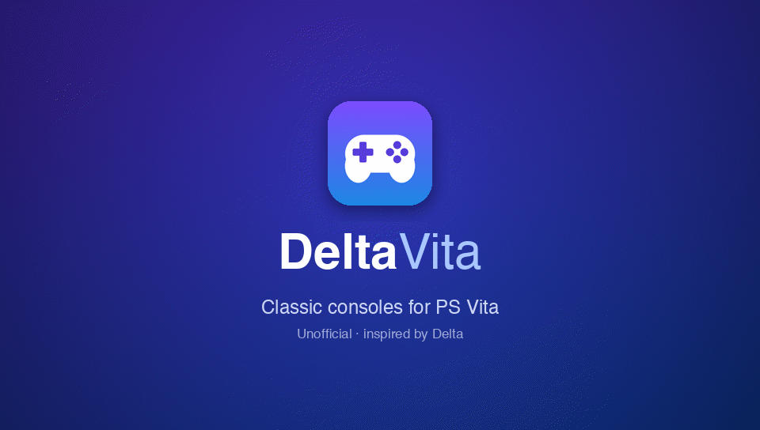

<h1 align="center">
  <br>
  DeltaVita · PS Vita Port
</h1>

<p align="center">
  <a href="#-status--playability">Status & Playability</a> •
  <a href="#setup-instructions-for-players">How to install</a> •
  <a href="#controls">Controls</a> •
  <a href="#known-issues">Known Issues</a> •
  <a href="#build-instructions-for-developers">How to compile</a> •
  <a href="#credits--acknowledgments">Credits</a>
</p>

> [!IMPORTANT]
> **Unofficial port.** DeltaVita is a fan-made, unofficial port inspired by Delta. It is **not affiliated with, endorsed, sponsored or supported by Riley Testut, AltStore LLC or the Delta project**. "Delta" and the Delta logo belong to their respective owners. Please do not report DeltaVita issues to the Delta project. No games, BIOS files or Delta skins are distributed with DeltaVita.
>
> **Port no oficial.** DeltaVita es un port no oficial hecho por fans, sin relación ni respaldo de Riley Testut, AltStore LLC ni del proyecto Delta.

An unofficial, native **PS Vita take on [Delta](https://github.com/rileytestut/Delta)**, Riley Testut's multi-system iOS emulator. DeltaVita is not affiliated with Delta or Riley Testut. It is a native launcher (vita2d) plus one libretro core per console, each statically linked into its own app and started with `sceAppMgrLoadExec`. Its sister project is [DeltaDroid](https://github.com/MetalSyntax/DeltaDroid) (Android).

## Download

- Download `DeltaVita.vpk` from the [GitHub Releases page](https://github.com/MetalSyntax/DeltaVita/releases).
- **Status: first public BETA, version 0.1.0-beta.** See [Status & Playability](#-status--playability) for what has been tested on hardware.

---

## 🎮 Status & Playability

**Status: BETA (0.1.0-beta)**

First public beta. Tested on a real PS Vita with NES, SNES and GBA games (3 ROMs), plus GB and NES test ROMs. DS and N64 are untested on hardware, and Genesis is untested too. N64 is not included.

- [x] **Build**: `DeltaVita.vpk` (title ID `DLTV00001`, VPK version `00.10`) compiles from source. Release `0.1.0-beta` (the VPK's app version field is `00.10`).
- [x] **Launcher**: Delta-style library, one page per console, cover grid, front touch selection. *Verified on console.*
- [x] **NES** (fceumm): core runs and games launch. *Verified on console.*
- [x] **SNES** (snes9x2005): core runs and games launch. *Verified on console.*
- [x] **GBA** (gpSP, dynarec via VM memblock): core runs and games launch. *Verified on console.*
- [x] **Pause menu**: save state, cheats, fast forward and the rest of the menu. *Verified on console.*
- [x] **Box art download** over Wi-Fi (HTTPS with OpenSSL). *Verified on console.*
- [ ] **GB/GBC** (gambatte): test ROM only.
- [ ] **Genesis / Mega Drive** (genesis_plus_gx): not tested.
- [ ] **DS** (desmume2015): experimental, interpreter, slow. Not tested.
- [ ] **N64** (parallel_n64): **not included yet**. Its upstream Vita target is broken (it references a removed `empty_dynarec.c`), and with an interpreter plus software renderer it would run at a few FPS. The launcher, skin and controls are ready for it.
- [ ] **Saves**: battery saves (SRAM) and save states survive a restart.
- [ ] **Skins**: Classic (built in) and converted Delta skins, in portrait and landscape.
- [ ] **Audio**, **fast-forward**, **cheat codes**.

---

## Disclaimer

**Delta** is a project by **Riley Testut**. DeltaVita is an unofficial port and is not produced, endorsed, or sanctioned by Riley Testut or any affiliated entities.

This software does NOT contain game ROMs, BIOS files, original game code, copyrighted graphics, or game assets. The **Classic** skins in this repository are original work, generated by `tools/make_skins.py`. Delta's own skins are not included and are not redistributable. `tools/fetch_assets.sh` can swap them in from **your own** Delta IPA for personal use only. The authors do not promote or condone piracy in any way. To play, you must provide your own legally obtained game ROMs and, where a system requires it, your own BIOS files.

---

## Setup Instructions (For Players)

1. **Install the VPK**: install `DeltaVita.vpk` with VitaShell.
2. **Copy your ROMs** to `ux0:data/DeltaVita/roms/` (subfolders are read up to 2 levels deep).
3. **Optional BIOS**: place files required by a system in `ux0:data/DeltaVita/system/`.
4. **Optional skins**: copy converted skins to `ux0:data/DeltaVita/skins/<console>/` (see [Skins](#skins)).
5. **Start DeltaVita** and pick a console page.

The data folder is created automatically:

```
ux0:data/DeltaVita/
  roms/           your game files (subfolders up to 2 levels)
  saves/          battery saves (SRAM)
  states/<rom>/   save states (8 slots + Auto Save)
  cheats/         cheat code lists
  covers/         box art (downloaded or added by you)
  screenshots/    screenshots taken from the pause menu
  skins/<console>/ skins per console (nes snes gbc gba n64 ds genesis)
  system/         optional BIOS files
  config.txt      settings
  titles.txt      game titles
  launcher.log    launcher log
  runner.log      emulation log
```

Interface language is Spanish or English, following the system language.

### Skins

DeltaVita includes original **Classic** skins for all seven consoles, in portrait and landscape. They are built in and are the default (the Settings entry is named "Classic"). Delta's own skins are not included.

To use another skin, convert a `.deltaskin` on a PC:

1. Convert it with `tools/deltaskin2vita.py` (needs poppler's `pdftocairo` and Pillow), for example `python3 tools/deltaskin2vita.py skin.deltaskin skin-vita.deltaskin`. Skin PDFs are pre-rendered on the PC because the Vita cannot render PDF.
2. Copy the result to `ux0:data/DeltaVita/skins/<console>/`.
3. Choose it in Settings.

Converted skins use the `iphone` / `standard` representation (667x375, close to the Vita's aspect ratio), in portrait and landscape.

On-screen skin buttons respond to multitouch. The N64 skin uses the analog thumbstick, and the DS skin maps its touch screen to the front touch panel.

---

## Controls

Physical buttons are mapped by position, as in Delta.

| Input | Action | Status |
| :---: | :--- | :---: |
| **✕** | B | beta |
| **○** | A | beta |
| **□** | Y | beta |
| **△** | X (in the library: game options) | beta |
| **L / R** | L / R (N64: L = Z). Library: switch console page | beta |
| **START** | START (in the library: settings) | beta |
| **SELECT** | SELECT | beta |
| **Left stick** | D-pad (N64: analog stick) | beta |
| **Right stick** | N64 C-buttons | beta |
| **SELECT + START** | Open the pause menu (or the skin's MENU button) | beta |

> [!TIP]
> The pause menu has **Save State**, **Load State** (8 slots + Auto Save, PNG thumbnails, date, △ lock, □ delete), **Fast Forward**, **Reset**, **Screenshot**, **Cheat Codes** (add with the system keyboard, toggle, delete; Game Genie / Action Replay / GameShark depending on the core), **Hold Buttons** (tap a button to keep it held, tap again to release), **Mute**, **Use Skin**, **Rotate Screen**, and **Quit**. Battery saves are written when you pause and when you exit; an auto save state is written on exit.

In the library, **△** opens game options: **Play**, **Rename** (system keyboard), **Delete game**.

---

## Display Modes & Limitations

| Setting | Options |
| :--- | :--- |
| **Orientation** | Landscape or portrait. In portrait, everything (menus included) is rendered into a 544x960 target rotated 90°. Hold the Vita rotated with its left edge up. The D-pad and sticks rotate with the image. |
| **Skin** | No skin, Classic (built in), or imported skins, per console |
| **Skin opacity** | Adjustable for translucent landscape skins |
| **Scaling without skin** | Fit, Integer, or Stretch |
| **Filter** | Smooth filter on/off |
| **Fast-forward** | 2x, 3x, 4x, 8x |
| **Box art** | Download over Wi-Fi (libretro-thumbnails, matched by No-Intro file name, saved to `ux0:data/DeltaVita/covers/`) |

---

## Known Issues

- **Only part of the library has been tested on hardware**: NES, SNES and GBA games (3 ROMs) on a real PS Vita. GB/GBC has only run a test ROM. DS and Genesis are untested. Expect problems on those systems.
- **DS is experimental and slow** (interpreter); **N64 is not included yet** (see Status).
- **Box art download uses HTTPS with OpenSSL.** It does **not** verify the server certificate (the Vita has no CA store for OpenSSL); only public images are downloaded.
- **Skins**: only the `iphone` / `standard` representation is used.
- **Cheat codes**: one cheat code list per game.
- **PAL games** are paced against the 60 Hz display.
- **Crash dumps** are written by the system to `ux0:data/` (not to the game folder).

---

## Build Instructions (For Developers)

### Prerequisites

- [VitaSDK](https://vitasdk.org/) (`$VITASDK`).
- CMake 3.16+, Ninja, Python 3, `git`, and `unzip`.
- For `tools/deltaskin2vita.py` only: poppler (`pdftocairo`) and Pillow.

The Classic skins are in the repository (`assets/skins`). The libretro cores are **not** in the repository; `tools/build_cores.sh` builds them. Delta's skins are never in the repository.

### Compilation Commands

```bash
git clone https://github.com/MetalSyntax/DeltaVita
cd DeltaVita
# 1. build the libretro cores as static libraries for Vita (cloned into cores/src, output in cores/lib)
tools/build_cores.sh
# 2. optional, PERSONAL USE ONLY: replace the Classic skins with Delta's Standard skins from YOUR OWN Delta IPA
#    (to go back to Classic: git checkout assets/skins)
tools/fetch_assets.sh /path/to/Delta.ipa
# 3. build the VPK
cmake -S . -B build -G Ninja -DCMAKE_POLICY_VERSION_MINIMUM=3.5
cmake --build build
```

The result is `build/DeltaVita.vpk`. `tools/build_cores.sh` patches the cores' Makefiles from hard-float to softfp, because this VitaSDK is softfp. Cores that fail to build are skipped, and the matching console is left out of the VPK.

Do not publish a VPK built with step 2. Delta's skins are not licensed for redistribution.

### Deploy & Debug

Upload the VPK with VitaShell's FTP server, then install it from VitaShell:

```bash
curl -T build/DeltaVita.vpk ftp://<vita-ip>:1337/ux0:/downloads/
```

Logs are written to `ux0:data/DeltaVita/launcher.log` and `ux0:data/DeltaVita/runner.log`.

---

## ☕ Support My Work

This project is **free** and will stay free. If you enjoy it, a tip from **$1** helps me keep working on it:

<p align="center">
  <a href="https://ko-fi.com/metalsyntax"></a>
</p>

- **Ko-fi:** [ko-fi.com/metalsyntax](https://ko-fi.com/metalsyntax)
- **PayPal:** [paypal.me/MetalSyntax](https://paypal.me/MetalSyntax)
- **Bitcoin (BTC):** `133HdCsaWxdjTfmwpgGVykByhNBV338uRc`

> Games, BIOS files and Delta's skins are never distributed. You always need your own legally obtained copies.

---

## Credits & Acknowledgments

- **Delta** by Riley Testut, licensed under AGPL-3.0. DeltaVita is inspired by Delta and uses the `.deltaskin` format for compatibility. Delta's skins and icon are not included; the LiveArea icon and the Classic skins are original (generated with `tools/make_icon.py` and `tools/make_skins.py` from the DeltaDroid repo).
- **libretro** and the core authors: [FCEUmm](https://github.com/libretro/libretro-fceumm), [Snes9x 2005](https://github.com/libretro/snes9x2005), [Gambatte](https://github.com/libretro/gambatte-libretro), [gpSP](https://github.com/libretro/gpsp), [Genesis Plus GX](https://github.com/libretro/Genesis-Plus-GX), [DeSmuME 2015](https://github.com/libretro/desmume2015), [ParaLLEl N64](https://github.com/libretro/parallel-n64).
- **libretro-common** by the libretro project.
- **libretro-thumbnails** for box art.
- **vitaSDK** by the vitasdk team.
- **vita2d** graphics library.
- **OpenSSL**, for HTTPS box art downloads.
- **cJSON** by Dave Gamble (MIT).
- **DeltaDroid** (sister project): [MetalSyntax/DeltaDroid](https://github.com/MetalSyntax/DeltaDroid).
- Special thanks to the PS Vita homebrew and porting community.

## License

DeltaVita is licensed under the **GNU General Public License v3.0** (GPL-3.0), because the libretro cores are GPL. See [LICENSE](LICENSE).
